# Prédiction des émissions de CO₂ des véhicules commercialisés en France

## Projet Data Scientist — Liora (anciennement DataScientest)

**Formation :** Data Scientist – Liora (anciennement DataScientest)

**Projet :** Émissions de CO₂ des véhicules commercialisés en France

**Groupe :**
- Larissa Varnakova
- Aziz Diallo

**Mentor :** Nicolas Mormiche

**Date :** Octobre 2026

---

# Sommaire

1. Introduction

2. Contexte du projet
   - 2.1 Contexte métier
   - 2.2 Contexte scientifique et technique
   - 2.3 Problématique
   - 2.4 Objectifs du projet

3. Présentation des données
   - 3.1 Origine des données
   - 3.2 Description du jeu de données
   - 3.3 Variable cible
   - 3.4 Variables explicatives
   - 3.5 Synthèse

4. Analyse exploratoire des données (EDA)
   - 4.1 Qualité des données
   - 4.2 Analyse descriptive et distributions
   - 4.3 Analyse graphique
   - 4.4 Corrélations
   - 4.5 Analyses statistiques
   - 4.6 Conclusions de l'EDA

5. Prétraitement et Feature Engineering
   - 5.1 Nettoyage des données
   - 5.2 Séparation Train/Test
   - 5.3 Traitement des valeurs manquantes
   - 5.4 Feature Engineering
   - 5.5 Détection et traitement des valeurs aberrantes
   - 5.6 Sélection des variables
   - 5.7 Encodage des variables catégorielles
   - 5.8 Préparation des données pour la modélisation
   - 5.9 Synthèse du prétraitement

6. Modélisation

7. Comparaison globale des modèles

8. Interprétation du modèle retenu avec SHAP

9. Conclusion générale de la modélisation

10. Difficultés rencontrées

11. Conclusion générale du projet

12. Perspectives d'évolution

Bibliographie

Annexes

---

# 1. Introduction

La réduction des émissions de gaz à effet de serre constitue aujourd'hui un enjeu majeur pour le secteur des transports. En France, les véhicules particuliers et utilitaires représentent une part importante des émissions de dioxyde de carbone (CO₂), ce qui conduit les pouvoirs publics et les constructeurs automobiles à renforcer les politiques de réduction de l'impact environnemental des véhicules.

Dans ce contexte, l'analyse des données relatives aux caractéristiques techniques des véhicules permet de mieux comprendre les facteurs influençant les émissions de CO₂. L'identification de ces facteurs constitue une étape essentielle avant la mise en œuvre de modèles prédictifs capables d'estimer les émissions d'un véhicule à partir de ses caractéristiques.

Ce projet s'inscrit dans le cadre de la formation **Data Scientist** de **Liora (anciennement DataScientest)**. Il repose sur l'étude d'un jeu de données regroupant les caractéristiques techniques de véhicules commercialisés en France ainsi que leurs émissions de CO₂. L'objectif est de conduire une démarche complète d'analyse, d'exploration et de préparation des données en vue de leur exploitation par des modèles de Machine Learning.

Ce rapport présente la démarche suivie tout au long du projet, depuis la compréhension des données jusqu'à la modélisation et à l'interprétation des résultats. Après une présentation du jeu de données, une analyse exploratoire est menée afin d'en comprendre la structure, d'identifier les principales relations entre les variables et de mettre en évidence les caractéristiques les plus influentes. Les opérations de prétraitement sont ensuite détaillées et justifiées, avant de présenter les modèles entraînés, leur comparaison et l'interprétation du modèle retenu.

# 2. Contexte du projet

## 2.1 Contexte métier

La réduction des émissions de gaz à effet de serre constitue un enjeu majeur pour le secteur des transports. En France, les véhicules routiers représentent une part importante des émissions de CO₂, ce qui conduit les pouvoirs publics et les constructeurs automobiles à renforcer les politiques visant à réduire leur impact environnemental.

Les réglementations européennes imposent des objectifs de plus en plus exigeants en matière d'émissions de CO₂. Une meilleure compréhension des facteurs influençant ces émissions permet aux constructeurs de développer des véhicules plus performants sur le plan environnemental, d'anticiper les contraintes réglementaires, de limiter les pénalités financières et d'accompagner les consommateurs dans le choix de véhicules moins polluants.

## 2.2 Contexte scientifique et technique

Les émissions de CO₂ dépendent de nombreuses caractéristiques techniques des véhicules, telles que la consommation de carburant, la puissance, la masse, le type de carburant ou encore l'hybridation. L'analyse de ces variables permet d'identifier les facteurs les plus influents et de mieux comprendre les mécanismes expliquant les différences d'émissions observées entre les véhicules commercialisés en France.

Ce projet s'inscrit dans une démarche de Data Science visant à préparer un jeu de données destiné à la modélisation prédictive. Il mobilise les principales étapes d'un projet de Machine Learning : exploration des données, traitement des valeurs manquantes, feature engineering, sélection des variables, encodage des variables catégorielles et préparation des jeux d'entraînement et de test. L'objectif est de construire un jeu de données fiable et directement exploitable par les modèles de prédiction.

## 2.3 Problématique

Les émissions de CO₂ d'un véhicule dépendent de nombreux paramètres techniques, tels que la motorisation, la puissance, la masse, le type de carburant ou encore la consommation. Identifier les variables les plus influentes constitue une étape indispensable avant la mise en œuvre d'un modèle prédictif fiable.

La problématique retenue dans ce projet est donc la suivante :

**Quels sont les principaux facteurs influençant les émissions de CO₂ des véhicules commercialisés en France et comment exploiter ces informations pour construire un modèle de Machine Learning capable de prédire ces émissions ?**

## 2.4 Objectifs du projet

L'objectif principal de ce projet est d'analyser les facteurs associés aux émissions de CO₂ et de construire une démarche de Machine Learning permettant de prédire ces émissions à partir des caractéristiques des véhicules.

Pour atteindre cet objectif, plusieurs étapes ont été réalisées :

- comprendre la structure du jeu de données ;
- évaluer la qualité des données et identifier les éventuelles anomalies ;
- analyser les relations entre les variables grâce à des méthodes statistiques et des visualisations adaptées ;
- mettre en œuvre un prétraitement rigoureux des données (traitement des valeurs manquantes, gestion des variables, encodage et préparation des jeux d'entraînement et de test) ;
- préparer un jeu de données directement exploitable par des modèles de Machine Learning ;
- entraîner, comparer et interpréter plusieurs modèles de régression afin d'évaluer leur capacité à prédire les émissions de CO₂.

### Synthèse

Ce chapitre définit le cadre du projet et les objectifs poursuivis. L'étude vise à identifier les principaux facteurs associés aux émissions de CO₂, à préparer un jeu de données de qualité et à disposer d'une base méthodologique adaptée à la modélisation prédictive.

# 3. Présentation des données

## 3.1 Origine des données

Le jeu de données utilisé dans ce projet recense les caractéristiques techniques et environnementales des véhicules commercialisés en France en 2014. Il est publié par l’ADEME sur la plateforme data.gouv.fr. L’ADEME acquiert ces données auprès de l’UTAC (Union Technique de l’Automobile, du Motocycle et du Cycle), chargée de l’homologation des véhicules avant leur mise en vente.

Les données regroupent notamment des informations relatives aux émissions de CO₂, à la consommation de carburant, aux caractéristiques des motorisations ainsi qu’aux principaux polluants réglementés.

Ces données constituent une base pertinente pour analyser les caractéristiques associées aux émissions de CO₂ des véhicules et construire des modèles prédictifs, conformément à la problématique étudiée dans ce projet.

## 3.2 Description du jeu de données

Le jeu de données est composé d'observations correspondant à des véhicules commercialisés en France en 2014. Chaque ligne représente un véhicule et chaque colonne décrit une caractéristique technique ou environnementale.

Les variables couvrent notamment :

- les informations d'identification des véhicules ;
- les caractéristiques techniques (puissance, cylindrée, masse, type de carburant, transmission, etc.) ;
- les consommations de carburant ;
- les émissions de CO₂ ;
- les émissions des principaux polluants atmosphériques.

La variable cible retenue pour ce projet est **CO₂**, exprimée en grammes par kilomètre (g/km).

## 3.3 Variable cible

L'objectif de la modélisation est de prédire les émissions de CO₂ d'un véhicule à partir de ses caractéristiques.

Cette variable quantitative constitue donc la variable cible de l'ensemble des analyses. Les étapes d'exploration et de prétraitement visent à identifier les variables pertinentes et à préparer un jeu de données de qualité pour l'entraînement et l'évaluation des modèles de Machine Learning.

## 3.4 Variables explicatives

Les variables explicatives disponibles décrivent plusieurs dimensions des véhicules : leurs caractéristiques techniques, leur motorisation, leur masse, leur puissance, leur consommation de carburant, leur type de transmission ainsi que certaines caractéristiques environnementales.

Au cours de l'analyse exploratoire et du prétraitement, ces variables sont étudiées afin d'évaluer leur qualité, leur relation avec la variable cible, leur éventuelle redondance et leur pertinence pour la modélisation. Certaines variables sont conservées directement, tandis que d'autres sont supprimées ou transformées selon les résultats des analyses.

## 3.5 Synthèse

Le jeu de données retenu offre une base d'analyse complète pour étudier les émissions de CO₂ des véhicules commercialisés en France. La diversité des variables disponibles permet d'aborder la problématique sous différents angles et constitue un support solide pour les analyses exploratoires ainsi que pour la phase de modélisation.

# 4. Analyse exploratoire des données (EDA)

L'analyse exploratoire constitue une étape essentielle de tout projet de Data Science. Elle permet de comprendre la structure du jeu de données, d'évaluer sa qualité, d'identifier d'éventuelles anomalies et de mettre en évidence les premières relations entre les variables.

Cette phase conditionne l'ensemble des traitements réalisés par la suite. Elle permet notamment d'orienter les choix de prétraitement, de sélectionner les variables les plus pertinentes et de préparer les données en vue de leur modélisation.

## 4.1 Qualité des données

La première étape de l'analyse exploratoire a consisté à examiner la structure générale du jeu de données afin d'en évaluer la qualité et la cohérence.

Le jeu de données est composé de **55 044 observations** décrites par **30 variables**. Il regroupe des informations relatives aux caractéristiques techniques des véhicules, à leur motorisation, à leur consommation de carburant ainsi qu'à leurs émissions de CO₂ et d'autres polluants réglementés.

L'examen des types de variables met en évidence une majorité de variables catégorielles (chaînes de caractères) décrivant notamment les marques, les modèles, les carburants ou les transmissions, ainsi que plusieurs variables numériques correspondant aux caractéristiques techniques et environnementales des véhicules.

L'analyse des valeurs manquantes révèle que la majorité des variables sont complètes. En revanche, certaines variables présentent un taux important de valeurs manquantes. Les colonnes `Unnamed: 26` à `Unnamed: 29` sont entièrement vides (100 % de valeurs manquantes) et ne contiennent aucune information exploitable. La variable `date_maj` présente plus de **94 %** de valeurs manquantes, tandis que les variables `hc` et `hcnox` affichent respectivement environ **82 %** et **18 %** de données absentes.

À l'inverse, les variables directement liées à la problématique du projet présentent un très faible taux de valeurs manquantes. Les variables `ptcl`, `nox` et `co_typ_1`, qui seront conservées pour la suite des analyses, comportent moins de **5 %** de valeurs manquantes. Elles pourront donc être traitées lors de la phase de prétraitement sans dégrader significativement la qualité du jeu de données.

Cette première analyse confirme que le jeu de données est globalement de bonne qualité et qu'il est adapté à une démarche de modélisation après un prétraitement ciblé des variables concernées.

### Synthèse

L'évaluation de la qualité des données montre que le jeu de données est suffisamment fiable pour poursuivre les analyses. Les quelques anomalies identifiées concernent principalement des variables peu informatives ou fortement incomplètes, dont le traitement sera réalisé lors de la phase de prétraitement afin de disposer d'un jeu de données cohérent pour la modélisation.

## 4.2 Analyse descriptive et distributions

Après avoir vérifié la qualité générale du jeu de données, une analyse descriptive a été réalisée afin de mieux comprendre les caractéristiques des véhicules étudiés.

Comme l'illustre la **Figure 1**, l'examen des statistiques descriptives met en évidence une forte hétérogénéité des véhicules commercialisés en France en 2014. Les variables quantitatives, telles que la puissance du moteur, la cylindrée, la masse, la consommation de carburant ou encore les émissions de CO₂, présentent une dispersion importante, traduisant la diversité des modèles présents dans le jeu de données.

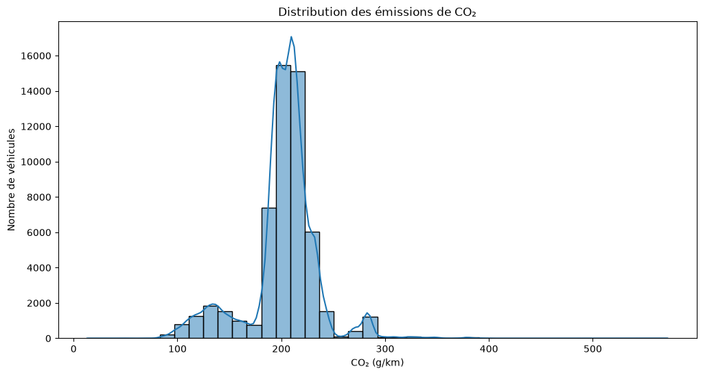

**Figure 1 – Distribution des émissions de CO₂ des véhicules du jeu de données.**

L'analyse de la variable cible montre que les émissions de CO₂ couvrent une plage de valeurs étendue, reflétant la coexistence de véhicules faiblement émetteurs et de véhicules plus énergivores. Cette variabilité constitue un point favorable pour la phase de modélisation, puisqu'elle permettra aux modèles d'apprendre sur un ensemble diversifié de situations.

Les statistiques descriptives mettent également en évidence la présence de valeurs extrêmes pour certaines variables techniques. Une analyse spécifique des valeurs aberrantes sera réalisée lors de la phase de prétraitement afin de déterminer si ces observations correspondent à de véritables véhicules atypiques ou à d'éventuelles anomalies.

Enfin, l'analyse des variables catégorielles révèle une répartition déséquilibrée entre certaines modalités. Les motorisations essence et diesel sont largement majoritaires, tandis que les motorisations hybrides et électriques sont présentes en effectifs beaucoup plus faibles, ce qui est cohérent avec le marché automobile français en 2014.

### Synthèse

L'analyse descriptive confirme la grande diversité des véhicules présents dans le jeu de données, tant en termes de caractéristiques techniques que d'émissions de CO₂. Cette variabilité constitue un contexte favorable pour approfondir les analyses et identifier les variables les plus étroitement liées aux émissions de CO₂.

## 4.3 Analyse graphique

Les visualisations réalisées au cours de l'analyse exploratoire ont permis de compléter les statistiques descriptives en mettant en évidence plusieurs relations importantes entre les caractéristiques techniques des véhicules et leurs émissions de CO₂.

L'étude de la distribution des émissions de CO₂ montre une forte variabilité des niveaux d'émission entre les véhicules commercialisés en France en 2014. Cette dispersion confirme l'intérêt de rechercher les variables les plus explicatives afin d'améliorer les performances des modèles prédictifs.

Comme l'illustre la **Figure 2**, la consommation de carburant présente une relation positive très marquée avec les émissions de CO₂. Une augmentation de la consommation s'accompagne généralement d'une augmentation des émissions. Cette tendance est particulièrement nette pour la consommation mixte, qui apparaît comme le meilleur indicateur des émissions de CO₂ parmi les différentes mesures de consommation. Ce résultat constitue l'un des principaux enseignements de l'analyse exploratoire et justifiera les choix réalisés lors de la phase de sélection des variables.

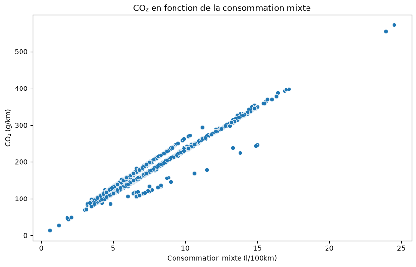

**Figure 2 – Relation entre la consommation mixte de carburant et les émissions de CO₂.**

Comme l'illustre la **Figure 3**, les émissions de CO₂ varient sensiblement selon le type de carburant. Les véhicules hybrides présentent globalement les niveaux d'émissions les plus faibles, tandis que les motorisations essence et diesel affichent des émissions plus élevées ainsi qu'une plus grande dispersion.

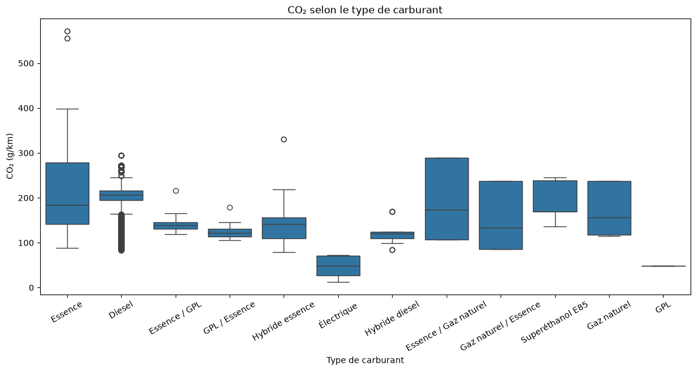

**Figure 3 – Distribution des émissions de CO₂ selon le type de carburant.**

La **Figure 3** met également en évidence une dispersion plus importante des émissions pour les motorisations essence et diesel. Les motorisations hybrides apparaissent plus homogènes et présentent globalement des niveaux d'émissions plus faibles.

Enfin, l'analyse des corrélations confirme que les variables liées à la consommation de carburant figurent parmi les meilleurs indicateurs des émissions de CO₂. À l'inverse, certaines variables techniques présentent une influence beaucoup plus limitée et seront réévaluées lors de la phase de sélection des variables.

### Synthèse

Les analyses graphiques mettent en évidence des relations claires entre les caractéristiques des véhicules et leurs émissions de CO₂. La consommation mixte apparaît comme le facteur le plus étroitement associé aux émissions, tandis que le type de carburant contribue également à expliquer les différences observées entre les véhicules. Ces constats seront vérifiés et quantifiés à l'aide des analyses statistiques présentées dans le chapitre suivant.

## 4.4 Corrélations

L'étude des corrélations a permis d'identifier les variables quantitatives les plus fortement associées aux émissions de CO₂.

Comme l’illustre la **Figure 4**, la matrice de corrélation des variables numériques met en évidence une forte relation positive entre les émissions de CO₂ et les différentes mesures de consommation de carburant. Elle permet également de visualiser les relations entre les autres caractéristiques quantitatives, ainsi que les corrélations existant entre variables explicatives.

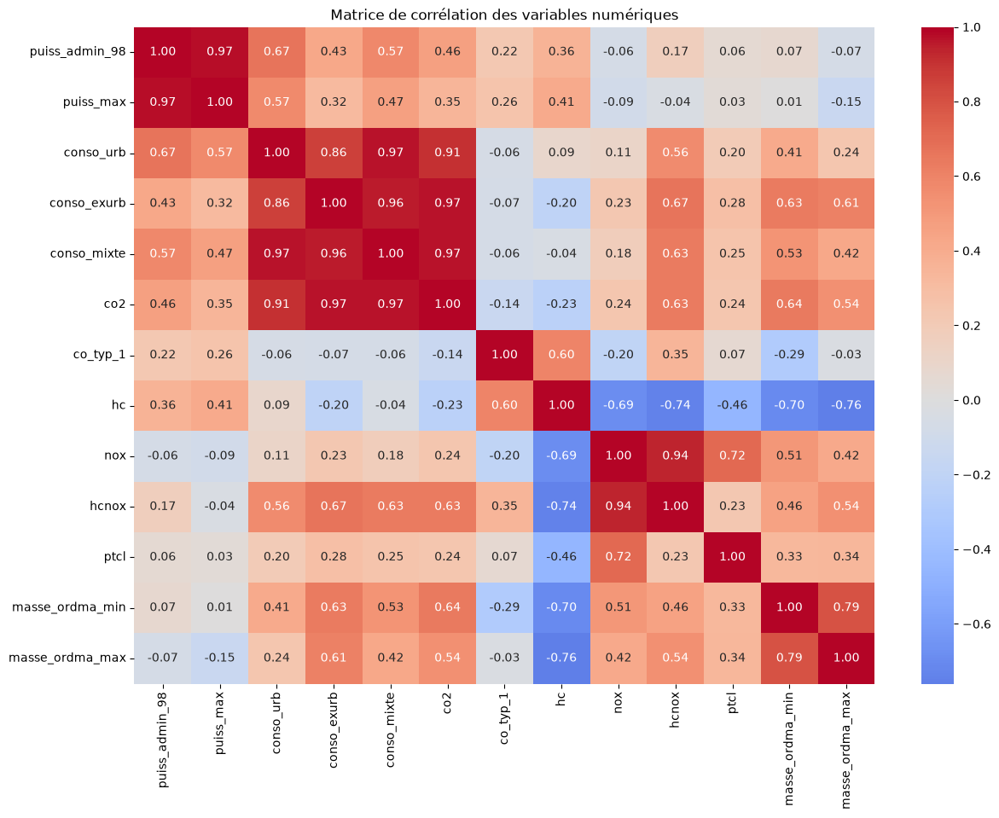

**Figure 4 – Matrice de corrélation des variables numériques.** Les coefficients représentent l'intensité et le sens des relations linéaires entre les variables. La corrélation ne constitue pas, à elle seule, une preuve de causalité.

La forte association entre les trois mesures de consommation apparaît également dans une matrice ciblée :

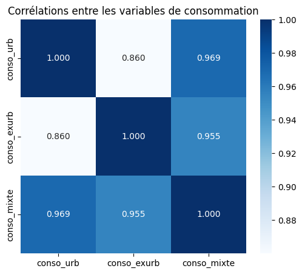

**Figure 5 – Corrélations entre les consommations urbaine, extra-urbaine et mixte, calculées sur le jeu d’entraînement.**

Les variables relatives à la masse du véhicule présentent également des corrélations positives importantes avec les émissions de CO₂. À l'inverse, certaines variables techniques présentent des coefficients de corrélation plus faibles, traduisant une association linéaire moins marquée avec les émissions.

Les coefficients de Pearson et de Spearman ont permis de confirmer ces résultats. Malgré des approches différentes (relation linéaire pour Pearson et relation monotone pour Spearman), les deux méthodes conduisent aux mêmes conclusions générales concernant les variables les plus influentes.

Ces résultats montrent que les variables liées à la consommation constituent les meilleurs indicateurs des émissions de CO₂. Ces observations ont directement guidé les choix réalisés lors de la phase de prétraitement, notamment la sélection des variables conservées pour la modélisation.

### Synthèse

Les analyses de corrélation confirment que les variables liées à la consommation de carburant sont les plus fortement associées aux émissions de CO₂. La masse du véhicule présente également une relation importante, tandis que les autres variables quantitatives exercent une influence plus modérée. Ces résultats constituent un premier appui objectif pour la sélection des variables en vue de la modélisation.

## 4.5 Analyses statistiques

### Analyse de variance (ANOVA)

Afin d'évaluer les différences d'émissions de CO₂ associées à plusieurs variables catégorielles, des analyses de variance (ANOVA) ont été réalisées.

Une première ANOVA a porté sur le type de carburant. Les résultats mettent en évidence des différences statistiquement significatives entre les différentes motorisations. Les émissions moyennes de CO₂ varient selon le carburant utilisé, confirmant que cette variable constitue un facteur explicatif majeur des émissions des véhicules.

Une deuxième analyse a été réalisée selon le type de carrosserie. Les résultats montrent également des différences significatives entre les différentes catégories de véhicules. Certaines carrosseries présentent des niveaux d'émissions moyens plus élevés que d'autres, traduisant des usages et des caractéristiques techniques différents.

Enfin, une troisième ANOVA a été menée selon la gamme des véhicules. Là encore, les différences observées entre les groupes sont statistiquement significatives. Les véhicules appartenant aux gammes supérieures présentent généralement des émissions de CO₂ plus importantes, ce qui s'explique notamment par une masse et une puissance plus élevées.

L'ensemble de ces résultats confirme que les variables catégorielles étudiées sont associées à des différences significatives d'émissions de CO₂. Elles devront donc être prises en compte lors de la phase de modélisation.

### Synthèse

Les analyses de variance montrent que le type de carburant, la carrosserie et la gamme sont associés à des différences significatives d'émissions de CO₂ entre les véhicules. Ces résultats confirment que ces variables catégorielles apportent une information pertinente pour expliquer la variabilité des émissions et devront être prises en compte lors de la phase de modélisation.

### Tests de Student

Un test de Student a été réalisé afin de comparer les émissions moyennes de CO₂ entre les véhicules hybrides et les véhicules non hybrides.

Comme l'illustre la **Figure 6**, les véhicules hybrides présentent des émissions de CO₂ globalement plus faibles que les véhicules non hybrides. Cette différence visuelle suggère que les deux groupes ne suivent pas la même distribution, ce qui justifie la réalisation d'un test de Student afin de déterminer si cet écart est statistiquement significatif.

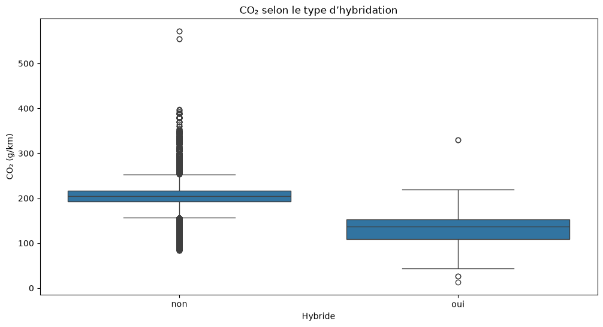

**Figure 6 – Distribution des émissions de CO₂ selon le type d'hybridation des véhicules.**

Les résultats du test mettent en évidence une différence statistiquement significative entre les deux groupes. Les véhicules hybrides présentent des émissions moyennes de CO₂ significativement plus faibles que les véhicules non hybrides. Ce résultat confirme les observations réalisées lors de l'analyse exploratoire et met en évidence une association entre l'hybridation et les niveaux d'émissions de CO₂.

Au-delà de son intérêt statistique, ce résultat est cohérent avec les caractéristiques techniques des véhicules hybrides, conçus pour réduire la consommation de carburant et, par conséquent, les émissions de dioxyde de carbone.

### Synthèse

Le test de Student confirme que les véhicules hybrides émettent significativement moins de CO₂ que les véhicules non hybrides. Ce résultat confirme les observations issues des analyses graphiques et met en évidence une différence significative d'émissions entre les deux groupes.

## 4.6 Conclusions de l'EDA

Les analyses statistiques ont permis de confirmer, de manière objective, les principales relations mises en évidence lors de l'analyse exploratoire. Elles montrent que les émissions de CO₂ dépendent à la fois de caractéristiques quantitatives, telles que la consommation de carburant et la masse du véhicule, et de caractéristiques catégorielles comme le type de carburant, la carrosserie, la gamme ou l'hybridation.

Ces résultats fournissent une base solide pour engager les différentes étapes du prétraitement et guider la sélection des variables utilisées lors de la modélisation.

# 5. Prétraitement et Feature Engineering

Le prétraitement constitue une étape essentielle d'un projet de Machine Learning. Son objectif est de transformer le jeu de données brut en un jeu de données fiable, cohérent et directement exploitable par les algorithmes de modélisation.

Les choix réalisés au cours de cette étape reposent sur les conclusions de l'analyse exploratoire et des analyses statistiques présentées dans les chapitres précédents. Chaque transformation a été réalisée dans le but d'améliorer la qualité des données tout en limitant les risques de biais ou de fuite d'information (*data leakage*).

Le prétraitement a été réalisé selon une démarche progressive comprenant le nettoyage des données, le traitement des valeurs manquantes, le **feature engineering**, la **sélection des variables**, l'encodage des variables catégorielles ainsi que la préparation des jeux de données destinés à la phase de modélisation.

## 5.1 Nettoyage des données

Les données brutes comprennent **55 044 observations et 30 variables**. Un contrôle des doublons stricts (égalité sur l'ensemble des colonnes) a identifié **7 lignes redondantes**, supprimées avant la séparation entraînement/test. Le jeu comprend alors **55 037 observations**. Une étape distincte supprime ensuite **34 observations pour lesquelles `co2` est manquant**, ce qui donne **55 003 observations exploitables**. Le découpage 80/20 produit exactement **44 002 observations pour l'entraînement** et **11 001 pour le test** (soit 55 003 au total). Il n'existe aucun écart inexpliqué dans les effectifs. Cette vérification évite qu'une observation strictement identique figure simultanément dans les deux partitions et ne fausse l'évaluation.

Une analyse complémentaire a été menée afin de distinguer les doublons stricts des véhicules présentant des caractéristiques identiques. Le jeu de données ne comporte pas d'identifiant unique permettant d'affirmer que deux lignes correspondent à un même véhicule. Les champs `cnit` et `tvv` décrivent des références techniques, mais ne constituent pas, à eux seuls, des identifiants uniques d'observation.

En comparant les lignes sur l'ensemble des colonnes d'origine **à l'exception de `cnit` et `tvv`**, nous avons identifié **4 388 groupes de caractéristiques identiques**, représentant **46 399 occurrences supplémentaires au-delà de la première occurrence de chaque groupe**, soit **50 787 observations au total dans ces groupes**.

Tous ces groupes présentent plusieurs valeurs distinctes de `cnit`. Ces répétitions ne peuvent donc pas être assimilées automatiquement à des doublons stricts : elles peuvent correspondre à des références d'homologation différentes pour des véhicules techniquement similaires.

En l'absence d'éléments permettant de confirmer leur redondance, **ces observations ont été conservées** afin d'éviter une perte d'information potentiellement pertinente. La suppression a ainsi été limitée aux **7 doublons stricts** identifiés initialement.

Les champs d'identification ou de description `cnit`, `tvv`, `dscom`, `lib_mod` et `lib_mod_doss` ont ensuite été exclus des variables explicatives finales en raison de leur forte cardinalité, de leur nature technique ou de leur intérêt limité pour la représentation retenue. Cette sélection de variables est distincte de la décision de conserver les observations techniquement similaires.

Les colonnes entièrement vides `Unnamed: 26` à `Unnamed: 29`, `date_maj` très incomplète, puis `hc` et `hcnox` ont été supprimées. La variable cible `co2` a été séparée des variables explicatives. Les choix d'imputation, d'encodage et de sélection sont détaillés ci-après.

## 5.2 Séparation Train/Test

Avant les opérations d'imputation et d'encodage, les données ont été séparées en un jeu d'entraînement et un jeu de test. Cette organisation permet d'évaluer les modèles sur des observations qui n'ont pas été utilisées pour ajuster les transformations ni pour entraîner les algorithmes.

Les statistiques nécessaires au prétraitement sont calculées uniquement à partir du jeu d'entraînement, puis appliquées au jeu de test. Cette démarche limite le risque de fuite d'information (*data leakage*) et garantit une évaluation plus représentative de la capacité de généralisation des modèles.

### Synthèse

La séparation Train/Test constitue une étape structurante du pipeline. Réalisée avant l'imputation et l'encodage, elle garantit que les informations issues du jeu de test n'interviennent pas dans l'apprentissage des transformations appliquées aux données.

## 5.3 Traitement des valeurs manquantes

L'analyse exploratoire a mis en évidence la présence de valeurs manquantes sur les variables `ptcl`, `nox`, `co_typ_1` et `conso_mixte`. Les taux de données manquantes observés sur ces variables permettaient d'envisager une imputation tout en conservant les observations concernées.

Avant de retenir une stratégie d'imputation, plusieurs approches ont été étudiées. Une imputation par marque de véhicule a notamment été envisagée. Cette solution n'a toutefois pas été retenue en raison de la forte disparité des effectifs entre les marques, certaines étant représentées par un nombre très limité de véhicules. Une telle approche aurait conduit à calculer des médianes sur des échantillons insuffisamment représentatifs.

L'analyse des médianes par type de carburant a ensuite montré que les variables `nox` et `co_typ_1` présentaient des différences importantes entre les motorisations essence et diesel. Cette caractéristique justifiait une imputation tenant compte du type de carburant.

Les stratégies retenues sont donc les suivantes :

- **`ptcl`** : imputation par la médiane globale calculée sur le jeu d'entraînement ;
- **`nox`** : imputation par la médiane du type de carburant (`cod_cbr`), avec recours à la médiane globale lorsque la catégorie ne permettait pas de calculer une médiane ;
- **`co_typ_1`** : même stratégie que pour `nox`, fondée sur la médiane par type de carburant complétée, si nécessaire, par une médiane globale ;
- **`conso_mixte`** : imputation par la médiane globale calculée sur le jeu d'entraînement, puis application de cette même valeur au jeu de test.

La variable `conso_mixte` occupant une place importante dans la prédiction des émissions de CO₂, son imputation permet de conserver les observations pour lesquelles cette information est manquante, sans utiliser les données du jeu de test pour déterminer la valeur de remplacement.

Conformément aux bonnes pratiques du Machine Learning, toutes les statistiques d'imputation ont été calculées exclusivement sur le jeu d'entraînement (`X_train`), puis appliquées à la fois au jeu d'entraînement et au jeu de test. Cette démarche permet d'éviter une fuite d'information (*data leakage*) du jeu de test vers le jeu d'entraînement lors de cette étape de prétraitement.

La vérification réalisée après l'imputation montre qu'aucune valeur manquante ne subsiste pour les variables `ptcl`, `nox`, `co_typ_1` et `conso_mixte`, confirmant la bonne application du prétraitement.

### Synthèse

Le traitement des valeurs manquantes repose sur une stratégie adaptée aux caractéristiques de chaque variable. L'imputation par la médiane globale ou par la médiane conditionnelle selon le type de carburant permet de conserver les observations tout en limitant les risques de biais et de fuite d'information. Les données sont désormais complètes pour les quatre variables concernées.

## 5.4 Feature Engineering

Dans le cadre du prétraitement, plusieurs variables dérivées ont été envisagées afin d'améliorer le pouvoir explicatif du jeu de données.

Une première variable, nommée `rapport_puissance_masse`, a été créée en calculant le rapport entre la puissance maximale du moteur (`puiss_max`) et la masse minimale du véhicule (`masse_ordma_min`). L'objectif était de représenter le niveau de puissance rapporté au poids du véhicule, un indicateur susceptible d'influencer les émissions de CO₂.

L'analyse de cette nouvelle variable montre une corrélation linéaire faible avec les émissions de CO₂ (≈ 0,089). Toutefois, une faible corrélation linéaire ne signifie pas nécessairement qu'une variable ne présente aucun intérêt prédictif, notamment pour les modèles capables de représenter des relations non linéaires.

Une seconde variable, nommée `rapport_puissance_masse_max`, fondée sur le rapport entre la puissance maximale et la masse maximale du véhicule (`masse_ordma_max`), a également été évaluée. Là encore, la corrélation observée avec les émissions de CO₂ est restée faible (≈ 0,054).

L'analyse des relations entre les deux variables dérivées a cependant mis en évidence une **très forte corrélation entre elles (≈ 0,985)**, traduisant une importante redondance.

Afin de limiter cette redondance tout en conservant une information potentiellement utile à la modélisation, **`rapport_puissance_masse` a été conservée**, tandis que **`rapport_puissance_masse_max` a été supprimée**.

Ces essais illustrent une démarche de feature engineering consistant à créer puis à évaluer de nouvelles variables avant de décider de leur conservation, en tenant compte à la fois de leur relation avec la variable cible et de leur redondance avec les autres caractéristiques.

### Synthèse

Les deux ratios puissance/masse créés lors de cette phase ont été évalués avant leur intégration au jeu de données final. Malgré leur faible corrélation linéaire avec les émissions de CO₂, **`rapport_puissance_masse` a été conservée**, tandis que **`rapport_puissance_masse_max` a été écartée** en raison de leur forte redondance.

Cette étape confirme que la sélection des variables ne doit pas reposer uniquement sur leur corrélation avec la cible, mais également sur leur complémentarité et leur intérêt potentiel pour les modèles de Machine Learning.

## 5.5 Détection et traitement des valeurs aberrantes

La présence de valeurs aberrantes a été étudiée sur les principales variables quantitatives du jeu de données, notamment les émissions de CO₂, les consommations de carburant, la puissance du moteur et la masse des véhicules.

Des boxplots ont été réalisés afin d'identifier les observations situées à l'extérieur des intervalles habituels de chaque distribution. Ces visualisations mettent effectivement en évidence plusieurs valeurs extrêmes.

Toutefois, la présence d'une valeur extrême ne signifie pas nécessairement qu'il s'agit d'une erreur de mesure ou de saisie. Dans le contexte automobile, certaines valeurs élevées peuvent notamment s'expliquer par les caractéristiques techniques de véhicules particulièrement puissants, lourds ou à forte consommation.

Les analyses réalisées ne permettent pas d'affirmer que l'ensemble de ces observations constitue des erreurs. En l'absence d'éléments suffisants pour justifier leur suppression, le choix a été fait de **conserver les valeurs atypiques** dans le jeu de données.

Cette décision permet de préserver la diversité des caractéristiques techniques représentées et d'éviter une réduction artificielle de la variabilité des données. Elle n'exclut toutefois pas la possibilité que certaines observations nécessitent des vérifications complémentaires.

### Synthèse

L'analyse des valeurs aberrantes a mis en évidence plusieurs observations extrêmes sur les variables quantitatives. Ces valeurs ne pouvant pas être systématiquement assimilées à des erreurs, **aucune suppression n'a été effectuée sur ce seul critère**.

Leur conservation permet de maintenir la variabilité du jeu de données et de prendre en compte des profils de véhicules présentant des caractéristiques techniques moins courantes lors de la modélisation.

## 5.6 Sélection des variables

Après le traitement des valeurs manquantes, le feature engineering et l'analyse des valeurs aberrantes, une étape de sélection des variables a été réalisée afin d'identifier les variables les plus pertinentes pour la modélisation.

Cette analyse s'appuie sur les résultats de l'analyse exploratoire, les corrélations observées entre les variables ainsi que sur les connaissances métier relatives aux caractéristiques techniques des véhicules. L'objectif est de limiter la redondance entre les variables explicatives, de réduire la complexité du modèle et de conserver uniquement les informations les plus pertinentes pour prédire les émissions de CO₂.

Les variables numériques ont tout d'abord été étudiées. La variable `champ_v9`, correspondant à une référence réglementaire d'homologation, a été supprimée en raison de son faible intérêt pour la modélisation. La variable `puiss_admin_98` a également été écartée, sa très forte corrélation avec `puiss_max` (0,973) traduisant une redondance importante. De même, les variables `conso_urb` et `conso_exurb` ont été supprimées au profit de `conso_mixte`, plus représentative de la consommation globale du véhicule et fortement corrélée aux émissions de CO₂. En revanche, les variables `masse_ordma_min` et `masse_ordma_max` ont été conservées, leur corrélation (0,795) restant insuffisante pour justifier la suppression de l'une d'elles.

Les variables textuelles ont ensuite été analysées. Les variables `cnit`, `tvv`, `dscom`, `lib_mod` et `lib_mod_doss` n'ont pas été retenues en raison de leur forte cardinalité, de leur nature technique ou de leur faible valeur ajoutée pour la modélisation. À l'inverse, les variables `lib_mrq`, `cod_cbr`, `hybride`, `Carrosserie`, `gamme` et `typ_boite_nb_rapp` ont été conservées afin d'être encodées avant la phase de modélisation.

### Synthèse

La sélection des variables a permis de supprimer les variables jugées redondantes ou peu pertinentes tout en conservant les caractéristiques les plus informatives du jeu de données. Cette étape contribue à simplifier le jeu de données, à limiter la redondance entre les variables explicatives et à préparer un encodage pertinent des variables catégorielles.

## 5.7 Encodage des variables catégorielles

À l'issue de la sélection des variables, les variables catégorielles retenues ont été transformées afin d'être exploitables par les algorithmes de Machine Learning.

Les variables conservées pour cette étape sont :

- `cod_cbr` (type de carburant) ;
- `hybride` ;
- `Carrosserie` ;
- `gamme` ;
- `lib_mrq` (marque du véhicule) ;
- `typ_boite_nb_rapp` (type de boîte de vitesses et nombre de rapports).

Les variables `cnit`, `tvv`, `dscom`, `lib_mod` et `lib_mod_doss` n'ont pas été encodées, car elles ont été écartées lors de l'étape de sélection des variables en raison de leur forte cardinalité, de leur nature technique ou de leur faible valeur ajoutée pour la modélisation.

L'encodage a été réalisé à l'aide de **OneHotEncoder** de la bibliothèque *scikit-learn*. Conformément aux bonnes pratiques du Machine Learning, l'encodeur a été ajusté uniquement sur le jeu d'entraînement (`X_train`), puis appliqué au jeu de test (`X_test`). Cette démarche permet d'éviter toute fuite d'information (*data leakage*).

Le paramètre `drop="first"` a été utilisé afin de supprimer une modalité de référence pour chaque variable catégorielle. Ce choix permet d'éviter une colinéarité parfaite entre les variables créées tout en conservant l'information utile à la modélisation.

Le paramètre `handle_unknown="ignore"` a également été retenu afin de garantir qu'une modalité absente du jeu d'entraînement mais présente dans le jeu de test puisse être traitée sans provoquer d'erreur lors de la transformation.

L'encodage des variables catégorielles retenues a ainsi permis de générer un ensemble de variables indicatrices directement exploitables par les modèles de Machine Learning.

### Synthèse

L'encodage des variables catégorielles a permis de transformer les variables qualitatives retenues en variables numériques tout en respectant les bonnes pratiques du Machine Learning. Réalisé après la sélection des variables et ajusté uniquement sur le jeu d'entraînement, il garantit une transformation cohérente des données avant leur utilisation par les modèles de prédiction.

## 5.8 Préparation des données pour la modélisation et standardisation

Après suppression de **7 doublons stricts** puis de **34 observations sans valeur de CO₂**, le jeu de données comprend **55 003 observations**, réparties entre **44 002 observations d’entraînement** et **11 001 observations de test**. L'encodage One-Hot des variables catégorielles aboutit à **93 variables explicatives**. Les opérations apprises sur les données (notamment imputation et encodage) sont ajustées sur l'entraînement et appliquées au test, afin de limiter les fuites d'information.

La **standardisation** consiste à centrer et réduire chaque variable numérique par les statistiques du jeu d'entraînement (`StandardScaler`). Elle n'a pas été appliquée indistinctement à tous les algorithmes. Les arbres de décision, Random Forest, XGBoost et LightGBM sont peu sensibles à un changement linéaire d'échelle des variables. À l'inverse, les pénalisations de Ridge et Lasso et l'optimisation d'un réseau MLP peuvent y être sensibles.

Une expérimentation dédiée a comparé les performances avec et sans standardisation pour la régression linéaire, Ridge, Lasso et le MLP. Pour ce dernier, deux réseaux de même architecture ont été entraînés avec des poids initiaux identiques, les mêmes données et les mêmes paramètres d'entraînement. La seule différence entre ces deux configurations concerne la standardisation des variables explicatives. Pour les recherches d'hyperparamètres Ridge/Lasso, la standardisation a été placée **dans un `Pipeline` scikit-learn**, afin d'être réajustée à l'intérieur de chaque pli de validation croisée et de ne pas utiliser les statistiques des plis de validation pendant l'entraînement. Les résultats sont détaillés en section 6.9.

Les jeux finaux ont fait l'objet de contrôles de dimensions, de types numériques et d'absence de valeurs manquantes.

## 5.9 Synthèse du prétraitement

Le prétraitement a permis de transformer le jeu de données initial en un ensemble de données fiable, cohérent et adapté à la phase de modélisation. Les différentes étapes mises en œuvre ont été guidées par les résultats de l'analyse exploratoire et des analyses statistiques, afin de conserver uniquement les informations les plus pertinentes.

Les jeux d'entraînement et de test obtenus sont complets, entièrement numériques et prêts à être utilisés pour entraîner et évaluer les modèles de prédiction des émissions de CO₂.

# 6. Modélisation

## 6.1 Objectif, protocole d'évaluation et logique de progression

Le jeu de modélisation comporte **44 002 lignes d'entraînement**, **11 001 lignes de test** et **93 variables explicatives** après encodage One-Hot. Les modèles sont comparés sur les mêmes données de test au moyen de la MAE, du RMSE, du R² et de la MAPE. Le RMSE pénalise plus fortement les grandes erreurs ; la MAE mesure l'erreur absolue moyenne ; le R² mesure la variance expliquée. Les valeurs de MAPE sont exprimées sous forme de proportion (par exemple 0,0017 correspond à 0,17 %).

L'ordre des modèles répond à une démarche progressive, plutôt qu'à une simple énumération : **DummyRegressor** établit un niveau minimal ; les **régressions linéaires** testent une relation additive simple et interprétable ; **Ridge et Lasso** examinent l'intérêt d'une régularisation ; un **arbre de décision** introduit des interactions et seuils non linéaires ; le **bagging de Random Forest** réduit la sensibilité à un arbre isolé ; les méthodes de **boosting XGBoost et LightGBM** construisent des arbres successifs pour corriger les erreurs ; enfin, le **MLP** teste une autre famille, fondée sur l'apprentissage de représentations non linéaires. Chaque changement de famille répond ainsi à une hypothèse de modélisation testable.

L'optimisation des hyperparamètres par `GridSearchCV` explore un ensemble de configurations prédéfini, en évaluant chaque configuration sur des plis de validation croisée du seul jeu d'entraînement. Le meilleur score de validation ne garantit pas une amélioration sur le test : les deux résultats sont distingués dans le rapport.

### Recherche d’hyperparamètres et validation croisée

La recherche par grille (`GridSearchCV`) consiste à définir explicitement plusieurs valeurs possibles pour chaque hyperparamètre, puis à évaluer toutes leurs combinaisons. Nous avons utilisé une **validation croisée à cinq plis** et le **R² comme critère de sélection** pour les modèles optimisés. À chaque itération, quatre plis servent à l’ajustement et le cinquième à la validation ; les performances sont moyennées pour comparer les configurations. Le jeu de test demeure distinct de cette recherche.

Cette méthode a été appliquée à Ridge et Lasso (intensité de régularisation `alpha`), à l’arbre de décision (profondeur et tailles minimales des nœuds et feuilles), à Random Forest (nombre et profondeur des arbres, seuils de division), ainsi qu’à XGBoost et LightGBM (nombre d’estimateurs, taux d’apprentissage, profondeur, et nombre de feuilles pour LightGBM). L’intérêt de cette procédure est de rendre explicites les compromis entre complexité, qualité d’ajustement et généralisation.

Les **courbes d’apprentissage** complètent la recherche par grille : elles comparent le R² obtenu sur l’entraînement et sur la validation croisée pour plusieurs tailles d’échantillon. Une différence persistante entre les courbes peut révéler une variance élevée ; deux courbes proches mais insuffisantes peuvent suggérer un biais important. À l’inverse, leur convergence vers des scores élevés témoigne d’une meilleure stabilité. 
Les courbes d'apprentissage de Random Forest, XGBoost et LightGBM sont présentées dans les sections consacrées à ces modèles.

## 6.2 Baseline : DummyRegressor

Un **DummyRegressor** a d'abord été utilisé comme modèle de référence. Il prédit systématiquement la moyenne de la variable cible et permet ainsi de disposer d'un niveau de performance minimal auquel comparer les autres modèles.

Les performances obtenues sont faibles : **MAE = 22,45 g/km**, **RMSE = 34,16 g/km**, **R² ≈ 0** et **MAPE = 0,1298**. Ce résultat confirme qu'une prédiction reposant uniquement sur la moyenne ne permet pas de représenter correctement la variabilité des émissions de CO₂.

Cette baseline constitue donc un point de comparaison utile pour mesurer l'apport réel des modèles de Machine Learning.

## 6.3 Modèles linéaires et régularisation

### 6.3.1 Régression linéaire

La régression linéaire constitue le premier modèle supervisé, choisi pour sa simplicité et son interprétabilité. Sur le jeu de test, elle obtient **MAE = 1,0922 g/km**, **RMSE = 1,7402 g/km**, **R² = 0,9974** et **MAPE = 0,0059**. Ces résultats montrent qu'une relation additive fournit déjà une prédiction très précise. Les graphiques réel/prédit, résidus et courbes d'apprentissage du notebook permettent d'examiner la qualité de l'ajustement au-delà du score global.

### 6.3.2 Ridge et Lasso

**Ridge** applique une pénalisation L2 qui limite les coefficients trop importants ; **Lasso** applique une pénalisation L1, susceptible d'annuler certains coefficients. Ces modèles permettent de tester si la régularisation améliore la robustesse ou simplifie la représentation. Les configurations optimisées sur les données d’entraînement atteignent : **Ridge : MAE = 1,0925, RMSE = 1,7401, R² = 0,9974, MAPE = 0,0060** ; **Lasso : MAE = 1,0922, RMSE = 1,7401, R² = 0,9974, MAPE = 0,0059**. Les erreurs sont exprimées en g/km pour MAE et RMSE.

L'optimisation de `alpha` par validation croisée conduit à des performances pratiquement identiques à la régression linéaire. Cela montre que la régularisation n'apporte ici aucun gain prédictif notable, même si elle conserve un intérêt méthodologique. Les résultats sans standardisation et après standardisation sont distingués en section 6.9.

## 6.4 Arbre de décision : introduction de la non-linéarité

L'arbre de décision segmente les observations à partir de seuils sur les caractéristiques, ce qui lui permet de modéliser des relations non linéaires et des interactions que la régression linéaire ne représente pas directement. Sur le jeu de test, l'arbre optimisé obtient **MAE = 0,1423 g/km**, **RMSE = 0,8176 g/km**, **R² = 0,9994** et **MAPE = 0,0010**.

L'amélioration par rapport aux modèles linéaires justifie le passage à la famille des arbres. Toutefois, un arbre unique peut être sensible à de petites variations de l'échantillon d'entraînement et au surapprentissage ; cette limite motive l'étude du **bagging** avec Random Forest. Les courbes d'apprentissage et les résidus du notebook permettent d'apprécier ces risques.

## 6.5 Random Forest : du modèle unique au bagging

Random Forest agrège des arbres entraînés sur des échantillons bootstrap et des sous-ensembles de variables. Cette combinaison réduit généralement la variance et la dépendance aux décisions d'un arbre isolé. Le modèle optimisé obtient **MAE = 0,0925 g/km**, **RMSE = 0,7112 g/km**, **R² = 0,9996** et **MAPE = 0,0006**. Il présente la **meilleure MAE** de la comparaison globale.

La grille de recherche a porté sur `n_estimators`, `max_depth`, `min_samples_split` et `min_samples_leaf`. La configuration retenue comprend **100 arbres**, une profondeur maximale de **20**, `min_samples_split=2` et `min_samples_leaf=1`. L’objectif était d’évaluer l’effet de la complexité des arbres et de leur nombre sur les performances, avec cinq plis de validation croisée. Le choix final repose sur les performances vérifiées et non sur le seul fait d'avoir exécuté une recherche. Random Forest améliore ici l'erreur absolue moyenne et le RMSE de l'arbre isolé ; pour explorer une stratégie d'ensemble différente, la famille du **boosting** est ensuite évaluée.

### Courbe d'apprentissage et généralisation

La courbe d'apprentissage de Random Forest permet d'étudier l'évolution des performances du modèle en fonction du nombre d'observations utilisées pour l'entraînement.

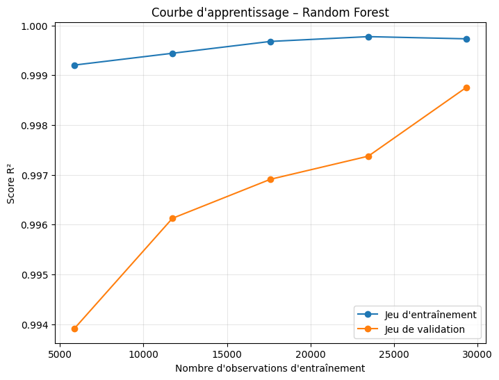

**Figure 7 – Courbe d'apprentissage de Random Forest – Validation croisée à trois plis.**

Les scores de validation augmentent avec la taille de l'échantillon, tandis que les scores d'entraînement restent très élevés. La réduction de l'écart entre les deux courbes montre que l'augmentation du nombre d'observations contribue à stabiliser les performances du modèle.

Cette analyse complète les résultats obtenus sur le jeu de test et permet d'apprécier la capacité de généralisation de Random Forest.

## 6.6 XGBoost : boosting et analyse des erreurs

### Principe et configuration

**XGBoost (Extreme Gradient Boosting)** repose sur un ensemble d’arbres construits successivement. Contrairement à Random Forest, qui agrège des arbres entraînés en parallèle, chaque nouvel arbre du boosting contribue à corriger les erreurs du modèle précédent. Cette stratégie permet d’apprendre des relations complexes entre caractéristiques techniques et émissions de CO₂, tout en contrôlant la complexité des arbres et l’amplitude des corrections.

Nous avons entraîné un premier modèle `XGBRegressor` avec **100 arbres** (`n_estimators=100`), une **profondeur maximale de 6** (`max_depth=6`), un **taux d’apprentissage de 0,1** (`learning_rate=0.1`) et une graine aléatoire fixée à **42**. Le nombre d’arbres détermine les étapes successives du boosting ; la profondeur contrôle la complexité des interactions représentées ; le taux d’apprentissage module la contribution de chaque arbre.

Sur le jeu de test, ce modèle obtient **MAE = 0,2908 g/km**, **RMSE = 0,5940 g/km**, **R² = 0,9997** et **MAPE = 0,0017**. Il présente le **RMSE le plus faible** et le **R² le plus élevé** de notre comparaison globale. Le R² d’entraînement (**0,9998**) reste proche de celui du test (**0,9997**).

### Recherche d’hyperparamètres avec GridSearchCV

Pour étudier l’influence des principaux réglages, nous avons défini une grille de **12 configurations** : `n_estimators` parmi **100 et 200**, `learning_rate` parmi **0,05 et 0,1**, et `max_depth` parmi **4, 6 et 8**. Avec une validation croisée à **5 plis**, cette recherche correspond à **60 ajustements**. Le critère d’optimisation est le R² moyen de validation croisée.

La meilleure configuration de cette grille utilise **200 arbres**, une **profondeur de 4** et un **taux d’apprentissage de 0,1**, avec un **R² moyen de validation croisée de 0,9992**. Son évaluation sur le jeu de test donne un **R² de 0,9996** et un **RMSE proche de 0,71 g/km**. Les performances du modèle initial sont légèrement meilleures sur le jeu de test : la recherche par grille apporte donc une comparaison structurée des hyperparamètres, sans garantir une amélioration systématique de toutes les métriques.

### Concordance entre valeurs réelles et prédictions

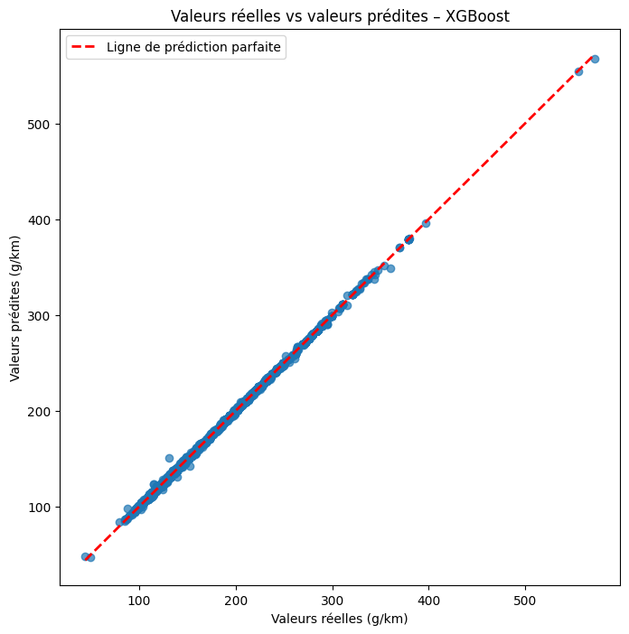

**Figure 8 – Émissions réelles et prédites par XGBoost sur le jeu de test.** Les observations sont très majoritairement proches de la diagonale de prédiction parfaite, ce qui confirme la précision globale du modèle.

### Analyse des résidus

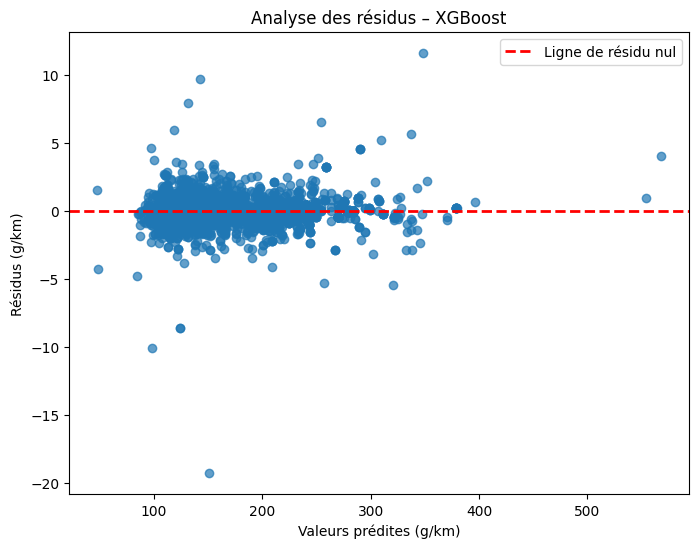

**Figure 9 – Résidus (`co2` réel moins `co2` prédit) en fonction des prédictions XGBoost.** La concentration des erreurs autour de zéro confirme la qualité de l’ajustement pour la majorité des véhicules. L’examen des points plus éloignés reste important : un R² très élevé ne signifie pas que chaque prédiction est exacte.

### Courbe d’apprentissage et généralisation

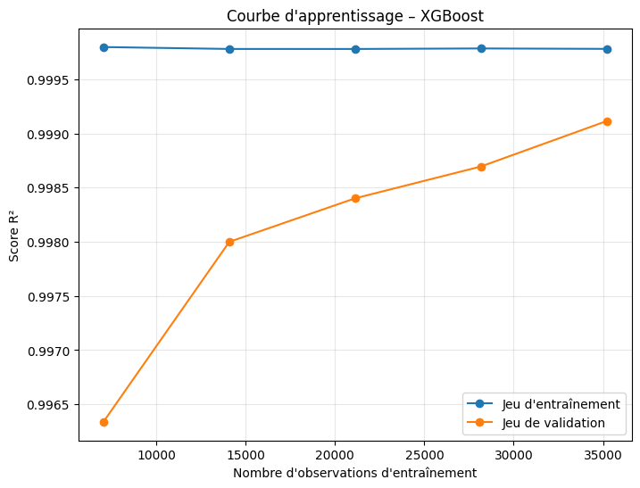

**Figure 10 – Courbe d’apprentissage de XGBoost : R² moyen sur entraînement et validation croisée à cinq plis.** Les scores de validation progressent avec le nombre d’observations disponibles et se rapprochent des scores d’entraînement. Cette représentation complète le diagnostic train/test : elle montre comment la quantité de données influe sur la stabilité de la prédiction.

### Interprétation des variables

L’analyse SHAP présentée au chapitre 8 complète ces diagnostics en mesurant la contribution des variables aux prédictions. Elle met notamment en évidence la place prépondérante de `conso_mixte`. Cette importance doit être interprétée en tenant compte de la forte relation entre consommation de carburant et émissions de CO₂, ainsi que des conditions dans lesquelles la consommation mixte est effectivement disponible pour prédire les émissions.

## 6.7 LightGBM : seconde méthode de boosting

LightGBM permet de confronter XGBoost à une autre implémentation du gradient boosting, avec une stratégie de construction des arbres différente. Le modèle optimisé atteint **MAE = 0,3701 g/km**, **RMSE = 1,2902 g/km**, **R² = 0,9986** et **MAPE = 0,0021** sur le jeu de test actualisé. Les essais de `GridSearchCV` servent à mesurer l'intérêt d'une optimisation des hyperparamètres plutôt qu'à présumer une amélioration systématique.

LightGBM reste performant mais présente ici un RMSE supérieur à celui de XGBoost et Random Forest. Cette comparaison confirme qu'aucune implémentation de boosting ne domine nécessairement toutes les autres.

### Courbe d'apprentissage et généralisation

Afin de compléter l'évaluation de LightGBM, une courbe d'apprentissage a été réalisée pour observer l'évolution des performances sur les données d'entraînement et de validation.

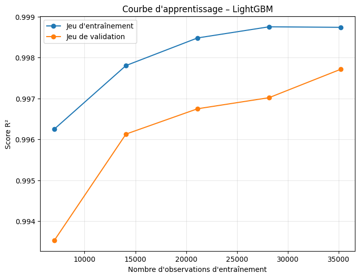

**Figure 11 – Courbe d'apprentissage de LightGBM – Validation croisée à cinq plis.**

Cette représentation permet de comparer les scores d'entraînement et de validation à mesure que le nombre d'observations augmente.

Elle complète l'analyse des performances obtenues sur le jeu de test et permet d'apprécier la capacité de généralisation de LightGBM, tout en offrant un point de comparaison supplémentaire avec XGBoost.

## 6.8 Expérimentations complémentaires et MLP

### 6.8.1 Transformation logarithmique et validation croisée

Une transformation logarithmique de la cible a été explorée dans le notebook principal. Après retour à l’échelle initiale, les scores R² sont de **0,9390 pour la régression linéaire**, **0,9419 pour Ridge** et **0,5737 pour Lasso**. Ces résultats sont inférieurs aux modèles sans transformation ; la transformation n’a donc pas été retenue.

La validation croisée à **5 plis**, réalisée sur les **44 002 observations d’entraînement**, donne les résultats suivants, lus directement dans les sorties actualisées du notebook principal :

| Modèle | R² moyen CV | Écart-type CV |
|---|---:|---:|
| XGBoost | 0,9991 | 0,0005 |
| Random Forest optimisé | 0,9991 | 0,0007 |
| LightGBM optimisé | 0,9980 | 0,0013 |

Les deux premiers modèles sont à égalité à quatre décimales sur le R² moyen, mais XGBoost présente une dispersion légèrement plus faible entre les plis. Cette validation croisée complète l’évaluation sur le jeu de test.

### 6.8.2 MLP : une autre famille de modèles

Le **Perceptron Multicouche (MLP)** explore une approche non linéaire différente des modèles fondés sur les arbres. L'architecture expérimentée comprend une couche d'entrée de **93 caractéristiques**, deux couches denses cachées de **64 et 32 neurones avec activation ReLU**, puis un neurone de sortie pour la régression, soit **8 129 paramètres**.

L'apprentissage utilise l'optimiseur **Adam**, la fonction de perte **MSE**, la métrique **MAE**, **100 epochs**, des lots de **32 observations** et une fraction de validation de **20 %** du jeu d'entraînement. Une graine aléatoire est fixée pour améliorer la reproductibilité.

Dans le notebook principal de modélisation, les variables explicatives ont été **standardisées à l'aide de `StandardScaler`** avant l'entraînement du MLP. Ce modèle obtient sur le jeu de test **MAE = 0,5863 g/km**, **RMSE = 1,5947 g/km**, **R² = 0,9978** et **MAPE = 0,0034**.

Une expérimentation complémentaire, présentée en section 6.9, a été réalisée afin d'évaluer spécifiquement l'effet de la standardisation sur les performances du MLP. Deux réseaux de même architecture ont été entraînés avec des poids initiaux identiques, les mêmes jeux de données et les mêmes paramètres d'entraînement. Seule la standardisation des variables explicatives diffère entre les deux configurations.

Cette comparaison contrôlée montre une amélioration importante des performances après standardisation : la **MAE passe de 9,1259 à 0,7971 g/km**, la **RMSE de 9,3855 à 1,3355 g/km** et le **R² de 0,9245 à 0,9985**.

Ces résultats mettent en évidence l'intérêt de la standardisation pour le MLP dans les conditions de cette expérimentation. Ils ne remplacent toutefois pas les résultats du notebook principal, les protocoles d'entraînement et de validation n'étant pas strictement identiques entre les deux notebooks.

Les courbes de perte d'entraînement et de validation permettent d'examiner la convergence et d'identifier un éventuel surapprentissage. Le suivi de la MSE sur les deux sous-ensembles est particulièrement utile : une baisse de la perte d'entraînement accompagnée d'une hausse durable de la perte de validation indiquerait une dégradation de la généralisation.

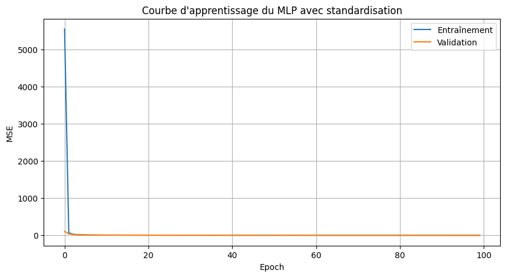

**Figure 12 – Évolution de la MSE du MLP standardisé du notebook principal sur les jeux d'entraînement et de validation.**

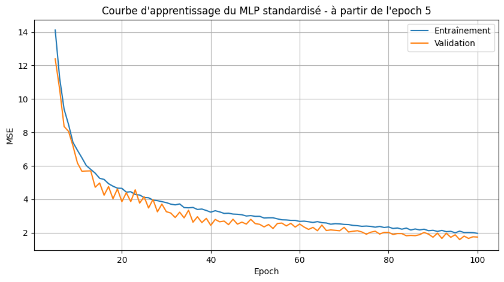

**Figure 13 – Évolution des pertes du MLP standardisé du notebook principal à partir de la cinquième epoch.** Ce zoom facilite la lecture de la convergence après les premières étapes d'apprentissage.

### 6.8.3 Expérimentation sans `conso_mixte`

Une expérimentation dédiée a été réalisée en supprimant la variable `conso_mixte` afin de mesurer la dépendance des modèles à cette caractéristique, identifiée comme le principal facteur prédictif des émissions de CO₂ lors des analyses précédentes.

Le nombre de variables explicatives passe ainsi de **93 à 92**, tandis que les jeux de données conservent **44 002 observations pour l'entraînement** et **11 001 pour le test**.

Sept modèles de régression ont été entraînés et évalués dans cette configuration :

| Modèle sans `conso_mixte` | MAE (g/km) | RMSE (g/km) | R² | MAPE |
|---|---:|---:|---:|---:|
| Régression linéaire | 9,63 | 12,92 | 0,8570 | 0,0496 |
| Ridge | 9,67 | 12,91 | 0,8572 | 0,0498 |
| Lasso | 12,37 | 16,99 | 0,7526 | 0,0639 |
| Arbre de décision | 3,19 | 5,40 | 0,9750 | 0,0173 |
| Random Forest | 3,17 | 4,82 | 0,9801 | 0,0170 |
| XGBoost | 3,34 | 4,82 | 0,9801 | 0,0181 |
| LightGBM | 3,71 | 5,44 | 0,9747 | 0,0201 |

Les résultats montrent une **dégradation des performances pour l'ensemble des modèles** après la suppression de `conso_mixte`. Cette diminution est particulièrement marquée pour les modèles linéaires, dont les coefficients de détermination deviennent nettement inférieurs à ceux obtenus lors de l'expérimentation principale.

Les modèles fondés sur les arbres conservent néanmoins des performances élevées. **Random Forest et XGBoost obtiennent les meilleurs résultats en termes de RMSE (4,82 g/km) et de R² (0,9801)**. Random Forest présente également la MAE la plus faible (3,17 g/km).

Pour XGBoost, modèle retenu dans l'étude principale, le R² passe de **0,9997 à 0,9801**, tandis que le RMSE augmente de **0,5940 à 4,82 g/km**. Malgré cette dégradation, le modèle conserve une capacité prédictive importante à partir des autres caractéristiques disponibles.

Cette expérimentation confirme le rôle majeur de `conso_mixte` dans la prédiction des émissions de CO₂. Elle montre également que les autres variables techniques contiennent des informations permettant de produire des estimations pertinentes, notamment avec les méthodes d'ensemble.

Elle souligne enfin l'importance de distinguer deux situations : la prédiction des émissions lorsque la consommation mixte est connue et leur estimation à partir des seules autres caractéristiques techniques du véhicule.

### 6.8.4 Target Encoding versus One-Hot Encoding

Une expérimentation complémentaire a évalué le **Target Encoding** comme alternative au One-Hot Encoding utilisé dans la modélisation principale.

Pour limiter les risques de fuite d'information, le Target Encoding a été réalisé selon une approche **out-of-fold à cinq plis** sur le jeu d'entraînement : chaque observation est encodée à partir des statistiques calculées sur les autres plis, sans utiliser directement sa propre valeur cible. Le jeu de test est ensuite transformé à l'aide d'un encodeur ajusté exclusivement sur l'ensemble du jeu d'entraînement.

Cette expérimentation permet de passer de **93 variables explicatives avec le One-Hot Encoding à 13 variables avec le Target Encoding**, soit une réduction de **80 colonnes (environ 86 %)**.

Les résultats obtenus sur les quatre modèles étudiés sont les suivants :

| Modèle | R² One-Hot Encoding | R² Target Encoding |
|---|---:|---:|
| Régression linéaire | 0,9974 | 0,9837 |
| Ridge | 0,9974 | 0,9829 |
| Lasso | 0,9923 | 0,9808 |
| Arbre de décision | 0,9991 | 0,9986 |

Dans les configurations évaluées, le **One-Hot Encoding obtient de meilleures performances sur les quatre modèles**, avec des écarts plus marqués pour les modèles linéaires. L'arbre de décision conserve néanmoins un excellent niveau de performance avec le Target Encoding (R² de 0,9986).

**Cette comparaison présente toutefois certaines limites méthodologiques.** Les pipelines de préparation ne sont pas strictement identiques : certaines variables explicatives et transformations diffèrent, notamment la standardisation appliquée aux modèles régularisés. Par conséquent, les écarts de performance observés ne peuvent pas être attribués exclusivement au choix de la méthode d'encodage.

De même, la réduction du nombre de variables résulte de la configuration globale des pipelines et ne peut pas être attribuée intégralement au seul Target Encoding.

Cette expérimentation montre néanmoins qu'il est possible de **réduire fortement la dimension du jeu de données tout en conservant des performances prédictives élevées**.

Une comparaison plus rigoureuse, reposant sur les mêmes observations, les mêmes variables explicatives et les mêmes paramètres de modélisation, permettrait de mesurer plus précisément l'effet propre de chaque méthode d'encodage.

La généralisation du Target Encoding à l'ensemble des modèles constitue ainsi une **perspective d'évolution intéressante**, à évaluer selon le compromis entre réduction de dimension, complexité du prétraitement et performances prédictives.

## 6.9 Étude spécifique de la standardisation
Une expérimentation complémentaire a été menée afin d'étudier l'intérêt de la standardisation des variables explicatives pour différentes familles de modèles, notamment la régression linéaire, Ridge, Lasso et le MLP.

La standardisation a été réalisée à l'aide de `StandardScaler`, en calculant les statistiques uniquement sur les données d'entraînement, puis en appliquant les transformations aux données de test. Pour le MLP, un découpage supplémentaire entre apprentissage et validation a été effectué afin de comparer deux réseaux dans des conditions d'entraînement identiques, sans utiliser les données de validation ou de test pour ajuster le scaler.

### Modèles linéaires

Les résultats obtenus avec et sans standardisation pour les modèles linéaires sont présentés ci-dessous :

| Modèle | MAE sans | MAE avec | RMSE sans | RMSE avec | R² sans | R² avec |
|---|---:|---:|---:|---:|---:|---:|
| Régression linéaire | 1,0922 | 1,0922 | 1,7402 | 1,7402 | 0,9974 | 0,9974 |
| Ridge optimisé | 1,0925 | 1,0925 | 1,7401 | 1,7401 | 0,9974 | 0,9974 |
| Lasso optimisé | 1,0922 | 1,0922 | 1,7401 | 1,7401 | 0,9974 | 0,9974 |

La régression linéaire présente des performances identiques à la précision affichée, avec ou sans standardisation. Ridge et Lasso optimisés conservent également des scores pratiquement inchangés.

La standardisation modifie toutefois l'échelle de la pénalisation : dans les expérimentations réalisées, l'`alpha` optimal de Ridge passe de **0,0001 à 1**.

### Expérimentations complémentaires sur le MLP

Afin d'évaluer spécifiquement l'effet de la standardisation sur les performances du Perceptron Multicouche (MLP), une expérimentation contrôlée a été réalisée en comparant deux configurations : l'une entraînée sur les données non standardisées et l'autre sur les données standardisées avec `StandardScaler`.

Les deux modèles utilisent une **architecture identique**, composée de deux couches cachées de **64 et 32 neurones avec activation ReLU**, suivies d'un neurone de sortie pour la régression, soit **8 129 paramètres**.

Pour garantir une comparaison équitable, les deux réseaux ont été initialisés avec **les mêmes poids** et entraînés avec **les mêmes paramètres** : optimiseur Adam, fonction de perte MSE, 100 epochs, batch size de 32 et désactivation du mélange des observations (`shuffle=False`).

Le jeu d'entraînement initial a été divisé en **35 201 observations d'apprentissage** et **8 801 observations de validation**, avec un jeu de test indépendant de **11 001 observations**. Le `StandardScaler` a été ajusté uniquement sur les données d'apprentissage, puis appliqué aux données de validation et de test.

Les performances obtenues sur le jeu de test sont les suivantes :

| Configuration | MAE (g/km) | RMSE (g/km) | R² | MAPE |
|---|---:|---:|---:|---:|
| MLP sans standardisation | 9,1259 | 9,3855 | 0,9245 | 0,0457 |
| MLP avec standardisation | 0,7971 | 1,3355 | 0,9985 | 0,0044 |

Les résultats montrent une **amélioration importante des performances du MLP après standardisation**. La MAE diminue d'environ **91,3 %**, passant de 9,1259 à 0,7971 g/km, tandis que le RMSE diminue d'environ **85,8 %**, passant de 9,3855 à 1,3355 g/km.

Le coefficient de détermination R² progresse également de **0,9245 à 0,9985**, ce qui traduit une meilleure capacité du réseau à reproduire les émissions de CO₂ observées.

Cette amélioration peut être attribuée à la standardisation dans les conditions de cette expérimentation, puisque **les deux modèles partagent la même architecture, les mêmes poids initiaux, les mêmes données et les mêmes paramètres d'entraînement**.

Les courbes d'apprentissage, représentées sur des échelles linéaire et logarithmique dans le notebook d'expérimentation, permettent également de comparer la convergence des deux réseaux au cours des 100 epochs.

Ces résultats montrent que la standardisation facilite ici l'optimisation du MLP et améliore sensiblement sa précision prédictive. Ils confirment l'intérêt d'adapter les transformations des données aux caractéristiques des algorithmes utilisés.

### Synthèse

La standardisation n'a pas apporté de gain notable sur les performances de la régression linéaire, de Ridge et de Lasso optimisés dans les configurations évaluées.

En revanche, **son effet est particulièrement marqué pour le MLP**. La comparaison contrôlée met en évidence une réduction d'environ **91 % de la MAE** et **86 % du RMSE**, ainsi qu'une amélioration du R² de **0,9245 à 0,9985**.

Cette expérimentation souligne que **l'intérêt de la standardisation dépend de la famille de modèles considérée**. Elle apparaît déterminante pour les performances du MLP dans le protocole étudié, alors qu'elle n'améliore pas significativement les résultats des modèles linéaires évalués.

# 7. Comparaison globale des modèles

| Modèle | MAE (g/km) | RMSE (g/km) | R² | MAPE |
|---|---:|---:|---:|---:|
| XGBoost | 0,2908 | 0,5940 | 0,9997 | 0,0017 |
| Random Forest | 0,0925 | 0,7112 | 0,9996 | 0,0006 |
| Arbre de décision | 0,1423 | 0,8176 | 0,9994 | 0,0010 |
| LightGBM | 0,3701 | 1,2902 | 0,9986 | 0,0021 |
| MLP standardisé (notebook principal) | 0,5863 | 1,5947 | 0,9978 | 0,0034 |
| Lasso optimisé | 1,0922 | 1,7401 | 0,9974 | 0,0059 |
| Ridge optimisé | 1,0925 | 1,7401 | 0,9974 | 0,0060 |
| Régression linéaire | 1,0922 | 1,7402 | 0,9974 | 0,0059 |
| DummyRegressor | 22,4525 | 34,1556 | ≈ 0 | 0,1298 |

*Source : sortie du tableau `comparaison_modeles` du notebook principal de modélisation. Les résultats de la comparaison contrôlée du MLP avec et sans standardisation sont présentés séparément en section 6.9 et ne sont pas intégrés à ce tableau.*

Tous les modèles supervisés surpassent largement le DummyRegressor. **XGBoost** obtient le meilleur R² et le meilleur RMSE, tandis que **Random Forest** minimise la MAE et la MAPE. La comparaison montre l'importance de ne pas désigner un « meilleur modèle » sans préciser le critère retenu. XGBoost est conservé comme modèle principal lorsque la réduction des erreurs importantes (RMSE) est privilégiée.

# 8. Interprétation du modèle retenu avec SHAP

Les performances prédictives ne suffisent pas à elles seules à comprendre le fonctionnement d'un modèle. Une analyse d'interprétabilité a donc été réalisée avec **SHAP (SHapley Additive exPlanations)** afin de mesurer la contribution des différentes variables aux prédictions de XGBoost.

## 8.1 Graphique de synthèse

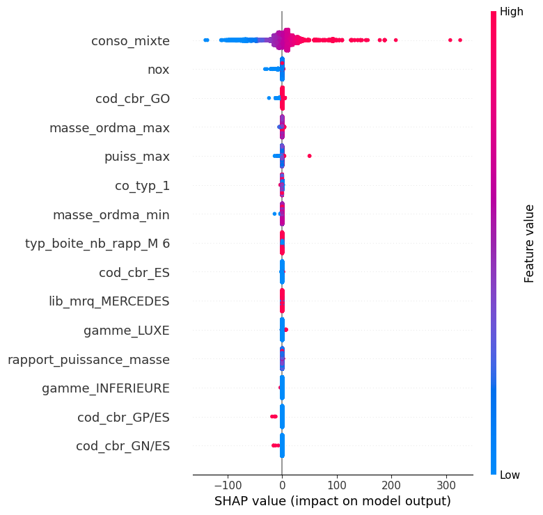

**Figure 14 – Graphique SHAP de synthèse du modèle XGBoost.**

L'analyse montre que **`conso_mixte`** est de très loin la variable la plus influente dans les prédictions du modèle. Les consommations élevées contribuent fortement à augmenter les émissions de CO₂ prédites, tandis que les faibles consommations contribuent à les diminuer.

Les variables **`nox`**, **`masse_ordma_max`**, **`puiss_max`** ainsi que certaines modalités liées au carburant interviennent également dans les prédictions, mais avec une influence nettement plus faible.

## 8.2 Importance globale des variables

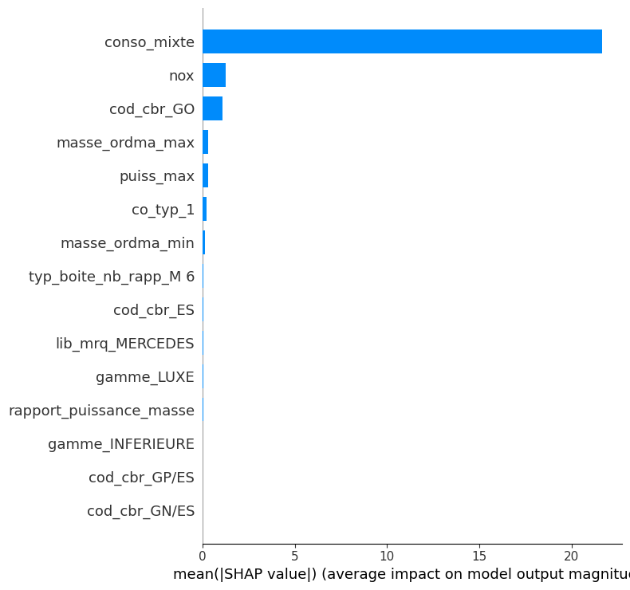

**Figure 15 – Importance globale des variables selon SHAP.**

Le graphique d'importance globale confirme la prédominance de **`conso_mixte`**, dont la valeur SHAP moyenne est très supérieure à celle des autres variables. Les variables `nox`, `cod_cbr_GO`, `masse_ordma_max` et `puiss_max` forment un second groupe de variables explicatives.

Cette hiérarchie est cohérente avec les résultats de l'analyse exploratoire, qui avait déjà mis en évidence la forte relation entre la consommation mixte et les émissions de CO₂. L'analyse SHAP permet ainsi de relier les performances du modèle aux principaux facteurs utilisés pour produire ses prédictions.

# 9. Conclusion générale de la modélisation

L'étude progressive des familles de modèles met en évidence l'intérêt des relations non linéaires et des ensembles d'arbres pour ce jeu de données. Les modèles linéaires expliquent déjà près de 99,74 % de la variance des émissions. L'arbre de décision améliore nettement les performances ; le bagging de Random Forest réduit encore les erreurs ; le boosting XGBoost obtient le meilleur RMSE (**0,5940 g/km**) et le meilleur R² (**0,9997**).

L'étude du MLP et de la standardisation montre que les transformations de données doivent être adaptées à la famille d'algorithmes. La comparaison contrôlée avec et sans standardisation met en évidence une amélioration importante des performances du MLP, tandis que les modèles linéaires optimisés présentent des résultats pratiquement inchangés. Le Target Encoding réduit la dimension sans améliorer les scores observés, et la suppression de `conso_mixte` révèle une dépendance importante du modèle à cette caractéristique. Les très hauts scores doivent donc être interprétés à la lumière des variables disponibles au moment de l'usage réel.

# 10. Difficultés rencontrées et limites

**Ressources de calcul.** Les recherches d'hyperparamètres, les validations croisées et l'entraînement du MLP ont mobilisé des ressources CPU et du temps d'exécution. L'absence ou l'indisponibilité d'une accélération GPU dans certains environnements a notamment ralenti les essais de réseau de neurones. Les grilles de recherche et les architectures ont été dimensionnées en conséquence.

**Environnement et collaboration.** Le travail en binôme a nécessité une coordination des versions de notebooks, des fichiers de données, des dépendances Python et des branches Git. Les changements d'environnement et les problèmes rencontrés avec Git ont demandé des vérifications supplémentaires pour conserver une version commune cohérente.

**Évaluation.** Les très bons scores obtenus sont liés notamment à la présence de `conso_mixte`, très proche du mécanisme physique de calcul des émissions. Cela ne constitue pas automatiquement une fuite de données au sens strict, mais limite l'intérêt opérationnel d'un modèle si la consommation mixte n'est pas connue lors de la prédiction. Les résultats sans cette variable constituent un contrôle de robustesse utile. Les résultats portent sur les véhicules du jeu de données 2014 : ils ne démontrent pas, à eux seuls, une généralisation à d'autres années, protocoles d'homologation ou véhicules électriques.

# 11. Conclusion générale du projet

Ce projet a couvert l'analyse exploratoire, le contrôle de qualité et des doublons, le prétraitement sans utilisation des statistiques du jeu de test, la modélisation et l'interprétation des émissions de CO₂ des véhicules commercialisés en France en 2014. Après suppression de **7 doublons stricts**, les données ont été préparées pour une modélisation sur **44 002 observations d'entraînement**, **11 001 de test** et **93 variables explicatives**.

Les familles linéaires, les arbres, le bagging, le boosting et le MLP ont été comparés. **XGBoost** constitue le modèle principal avec **R² = 0,9997** et **RMSE = 0,5940 g/km** sur le test ; **Random Forest** se distingue par une **MAE = 0,0925 g/km**. L'analyse SHAP confirme la prédominance de la consommation mixte dans les prédictions. L'expérimentation sans cette variable nuance la portée opérationnelle de ces performances. Les essais de Target Encoding ont permis d'étudier la réduction de la dimension des données, tandis que l'expérimentation contrôlée sur la standardisation a mis en évidence une amélioration importante des performances du MLP, sans gain notable pour les modèles linéaires évalués.

Ce travail illustre l’intérêt d’une démarche comparative associant préparation rigoureuse des données, évaluation des modèles et interprétation des prédictions. Il montre également l’importance de définir les variables disponibles au moment de l’utilisation du modèle.

# 12. Perspectives d'évolution

## 12.1 Approfondir le Target Encoding sans généralisation automatique

Le Target Encoding a réduit les variables de **93 à 13**, mais les quatre modèles testés ont obtenu des performances inférieures à celles du One-Hot Encoding. La perspective n'est donc plus de le généraliser d'emblée, mais d'étudier ses compromis entre dimension, temps de calcul, stabilité et précision, éventuellement sur d'autres algorithmes, avec un encodage hors pli pour prévenir les fuites de cible.

## 12.2 Développer un modèle de prédiction pour les véhicules non encore commercialisés

Une perspective d'évolution du projet consisterait à développer un modèle capable d'estimer les émissions de CO₂ de véhicules qui ne sont pas encore commercialisés, à partir de leurs caractéristiques techniques disponibles en phase de conception.

Contrairement au modèle principal, qui utilise notamment la consommation mixte de carburant (`conso_mixte`), cette approche pourrait s'appuyer sur des variables connues en amont, telles que la puissance du moteur, la masse du véhicule, le type de carburant ou encore l'hybridation.

L'expérimentation réalisée sans `conso_mixte` constitue une première étape dans cette direction. Les modèles Random Forest et XGBoost conservent un **R² de 0,9801** et un **RMSE de 4,82 g/km** sur le jeu de test, ce qui montre le potentiel prédictif des autres caractéristiques techniques.

Cette évolution pourrait permettre d'estimer les émissions de CO₂ de nouveaux véhicules avant leur commercialisation et d'accompagner la comparaison de différentes configurations techniques.

Toutefois, sa mise en œuvre nécessiterait de vérifier quelles variables sont réellement disponibles au moment de la prédiction et d'évaluer la capacité du modèle à généraliser ses résultats à de nouveaux véhicules, notamment à partir de données plus récentes.

## 12.3 Améliorer le MLP et l'optimisation

L'expérimentation contrôlée a confirmé l'intérêt de la standardisation pour le MLP, avec une amélioration importante des performances prédictives. Toutefois, le MLP standardisé du notebook principal demeure derrière les meilleures méthodes d'ensemble sur le RMSE. Des essais contrôlés avec `EarlyStopping`, `Dropout`, différentes architectures ou optimisation bayésienne pourraient être envisagés, en conservant un protocole comparable et un budget de calcul explicite.

## 12.4 Tester la généralisation temporelle et la reproductibilité

Une validation sur une autre année, sous réserve d'harmoniser les schémas de données, permettrait de mieux mesurer la robustesse hors échantillon. La documentation du pipeline et de son environnement constitue également un axe d’amélioration pour faciliter la réutilisation et le partage des travaux.

## 12.5 Approfondir l'analyse des doublons et leur influence sur la modélisation

L'analyse des doublons a permis d'identifier **7 doublons stricts**, supprimés lors du nettoyage, ainsi que **4 388 groupes de véhicules présentant des caractéristiques identiques** après exclusion des variables `cnit` et `tvv`.

Ces observations ont été conservées, car les informations disponibles ne permettent pas d'affirmer qu'elles correspondent à des véhicules réellement identiques.

Une perspective d'évolution consisterait à poursuivre cette analyse en retirant progressivement certaines colonnes d'identification, afin d'observer leur influence sur le nombre d'observations similaires et de mieux déterminer si ces répétitions correspondent réellement à des doublons.

Il serait également intéressant d'évaluer l'influence de ces observations sur les performances des modèles, notamment en comparant les résultats obtenus avec différentes stratégies de traitement des doublons.

Cette démarche permettrait de mesurer la robustesse des modèles face à la présence d'observations techniquement similaires et de mieux apprécier leur capacité de généralisation.

# Bibliographie

- **ADEME.** *Émissions de CO₂ et de polluants des véhicules commercialisés en France*. data.gouv.fr.  
  Source des données utilisées dans le projet :  
  https://www.data.gouv.fr/datasets/emissions-de-co2-et-de-polluants-des-vehicules-commercialises-en-france

- **Scikit-learn Developers.** *Scikit-learn – Machine Learning in Python*. Documentation officielle.  
  https://scikit-learn.org/stable/

- **Chen, T. & Guestrin, C. (2016).** *XGBoost: A Scalable Tree Boosting System*. Proceedings of the 22nd ACM SIGKDD International Conference on Knowledge Discovery and Data Mining, pp. 785–794.  
  https://doi.org/10.1145/2939672.2939785

- **Ke, G., Meng, Q., Finley, T., Wang, T., Chen, W., Ma, W., Ye, Q. & Liu, T.-Y. (2017).** *LightGBM: A Highly Efficient Gradient Boosting Decision Tree*. Advances in Neural Information Processing Systems, 30.  
  https://papers.nips.cc/paper/6907-lightgbm-a-highly-efficient-gradient-boosting-decision-tree

- **Lundberg, S. M. & Lee, S.-I. (2017).** *A Unified Approach to Interpreting Model Predictions*. Advances in Neural Information Processing Systems, 30.  
  https://proceedings.neurips.cc/paper/7062-a-unified-approach-to-interpreting-model-predictions

- **Keras.** *The Sequential model*. Documentation officielle.  
  https://keras.io/guides/sequential_model/

# Annexes

## Annexe A – Description des principales variables

| Variable        | Description                    |
| --------------- | ------------------------------ |
| co2             | Émissions de CO₂ (g/km)        |
| conso_mixte     | Consommation mixte (l/100 km)  |
| puiss_max       | Puissance maximale (kW)        |
| masse_ordma_min | Masse minimale homologuée (kg) |
| masse_ordma_max | Masse maximale homologuée (kg) |
| cod_cbr         | Type de carburant              |
| hybride         | Véhicule hybride (oui/non)     |
| Carrosserie     | Type de carrosserie            |
| gamme           | Gamme commerciale              |
| lib_mrq         | Marque du véhicule             |

## Annexe B – Résultats détaillés des tests statistiques

Les résultats détaillés des analyses statistiques réalisées au cours du projet (corrélations de Pearson et de Spearman, analyses de variance ANOVA, tests de Student et tests du Khi-deux) sont disponibles dans les notebooks d'analyse exploratoire fournis avec le projet.

Le présent rapport présente uniquement les principaux résultats nécessaires à la compréhension des analyses. Les notebooks permettent, quant à eux, d'accéder à l'ensemble des calculs, tableaux de résultats et sorties détaillées.

## Annexe C – Environnement technique

Les analyses ont été réalisées sous Python à l'aide d'un notebook Jupyter exécuté dans Visual Studio Code.

Les principales bibliothèques utilisées sont :

- pandas
- numpy
- matplotlib
- seaborn
- scipy
- scikit-learn
- XGBoost
- LightGBM
- SHAP
- TensorFlow / Keras

La gestion des versions et le travail collaboratif ont été assurés à l'aide de Git et GitHub.

## Annexe D – Grilles d'optimisation utilisées

| Modèle | Hyperparamètres étudiés | Méthode de sélection |
|---|---|---|
| Ridge et Lasso | `alpha` | GridSearchCV, R², 5 plis |
| Arbre de décision | `max_depth`, `min_samples_split`, `min_samples_leaf` | GridSearchCV, R², 5 plis |
| Random Forest | `n_estimators`, `max_depth`, `min_samples_split`, `min_samples_leaf` | GridSearchCV, R², 5 plis |
| XGBoost | `n_estimators` : 100/200 ; `learning_rate` : 0,05/0,1 ; `max_depth` : 4/6/8 | GridSearchCV, R², 5 plis |
| LightGBM | `n_estimators` : 100/200 ; `learning_rate` : 0,05/0,1 ; `max_depth` : 4/6/8 ; `num_leaves` : 31/50 | GridSearchCV, R², 5 plis |

